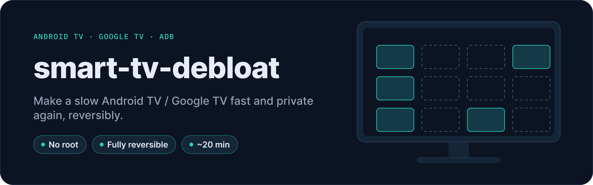
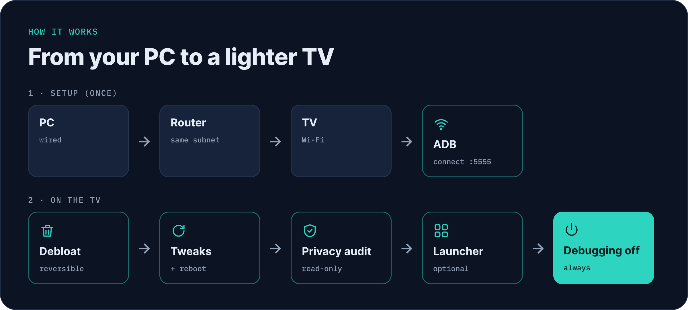
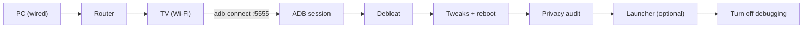
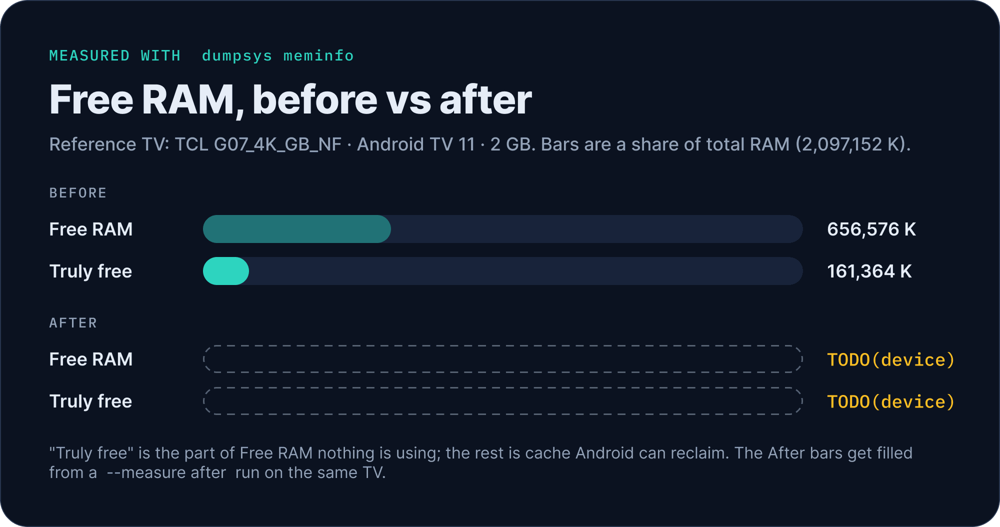
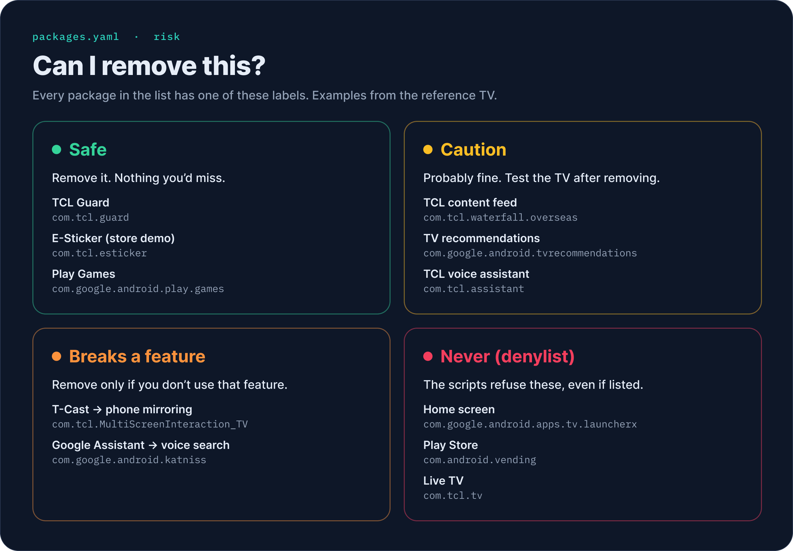

<p align="center">
  
</p>

**tv-debloat-android-google** removes the preinstalled apps that eat the RAM of Android TV / Google TV sets, speeds up
the menus, and checks who can use the microphone. It uses only the official **ADB** tool: no root, no hacks, and
every change can be undone. It's for anyone whose Android TV has become sluggish, whether you'd rather copy-paste
commands in Windows `cmd` or run one script.

What's different from generic debloat lists: it's **verified on real hardware** (first brand: a TCL G07), every package is
**labelled by risk and verified per model**, everything is **reversible** (a restore file is written as you go), and
results are **measured** (`dumpsys meminfo` before and after), not guessed.

## Choose your path

<table>
<tr>
<td width="33%" valign="top">

### 🧭 Manual walkthrough
**Recommended · Windows cmd**

Nine short steps, one command per box, with the expected output after each. You see exactly what happens.

**[Start the walkthrough →](docs/WALKTHROUGH.md)**

</td>
<td width="33%" valign="top">

### ⚡ One-command script
**PowerShell · macOS · Linux**

Asks before each removal, skips what your TV doesn't have, writes an undo file and measures RAM before/after.

**[Quickstart ↓](#30-second-quickstart)**

</td>
<td width="33%" valign="top">

### 🔒 Privacy check only
**Read-only**

Which apps can use the microphone, when they last did, and whether anything is recording. Changes nothing.

**[Privacy guide →](docs/PRIVACY.md)**

</td>
</tr>
</table>

> [!NOTE]
> **Samsung or LG?** Those run Tizen / webOS, not Android, so ADB debloating isn't possible there. You can still
> turn off their viewing-data tracking: see [other brands](docs/OTHER-BRANDS.md).

## 30-second quickstart

**On the TV first:** Settings → System → About → press **OK 7×** on *Android TV OS build*, then turn on
**USB debugging** and **Network debugging** in Developer options ([details](docs/WALKTHROUGH.md#step-1-enable-developer-options)).

**Windows (PowerShell 5.1 or 7)**, with [Platform Tools](docs/WALKTHROUGH.md#step-2-install-adb) installed:

```powershell
git clone https://github.com/ilker-ekin/tv-debloat-android-google
```

```powershell
cd tv-debloat-android-google
```

```powershell
powershell -ExecutionPolicy Bypass -File scripts\tv-debloat.ps1 192.168.1.50 -DryRun
```

Looks right? Run it for real. It asks before each package, and tier 3 always asks:

```powershell
powershell -ExecutionPolicy Bypass -File scripts\tv-debloat.ps1 192.168.1.50
```

<details>
<summary><b>macOS / Linux / Git Bash</b></summary>

```sh
brew install android-platform-tools        # macOS; Debian/Ubuntu: sudo apt install adb
```

```sh
git clone https://github.com/ilker-ekin/tv-debloat-android-google && cd tv-debloat-android-google
```

```sh
./scripts/tv-debloat.sh 192.168.1.50 --dry-run
```

```sh
./scripts/tv-debloat.sh 192.168.1.50
```

Works with the stock bash 3.2 on macOS. No `yq` or Python needed.

</details>

<details>
<summary><b>All script options</b></summary>

| PowerShell | bash | What it does |
|---|---|---|
| `-List` | `--list` | Show the package list (+ what's installed, if you give the TV's IP). Changes nothing |
| `-DryRun` | `--dry-run` | Show what would happen. No changes, no files |
| `-Tier N` | `--tier N` | Only offer tiers 1..N (default: all three) |
| `-Yes` | `--yes` | Don't ask for tiers 1–2. **Tier 3 always asks** |
| `-Keep a,b` | `--keep a,b` | Never touch these packages |
| `-User N` | `--user N` | Android user (default: the TV's current user; warns if there are several) |
| `-Port N` | `--port N` | ADB port (default 5555) |
| `-Measure before\|after` | `--measure before\|after` | RAM + package snapshot; `after` prints the difference |
| `-Restore FILE` | `--restore FILE` | Replay an undo file |
| `-Privacy` | `--privacy` | Run the read-only privacy audit |

Denylisted packages are refused in code, even if someone adds them to the list. Reports and undo files go to
`reports/`, which is git-ignored.

</details>

## How it works

<p align="center">
  
</p>

<details>
<summary>Text version</summary>



</details>

Apps are removed with `pm uninstall -k --user N`: they disappear for that Android user, but the app files stay on
the TV's system partition. That's why it's reversible: `cmd package install-existing` or a factory reset brings
them back.

## Results

<p align="center">
  
</p>

| TCL G07_4K_GB_NF · Android TV 11 · 2 GB | Before | After |
|---|---|---|
| Free RAM | 656,576 K | TODO(device) |
| └ truly free | 161,364 K | TODO(device) |
| Packages removed | | 23 |

Only measured numbers go here. See [RESULTS.md](docs/RESULTS.md) for the details and how to measure your own TV.

## What gets removed, and what's never touched

All decisions live in one file, [`packages.yaml`](packages.yaml): **33 packages** with a tier and a risk label
(23 verified on the reference TV), and a **denylist of 28** that is never touched.

<p align="center">
  
</p>

| Label | Meaning | Examples |
|---|---|---|
| **Safe** (25) | Remove it. Nothing you'd miss | TCL Guard, E-Sticker store demo, Play Games |
| **Caution** (5) | Probably fine. Test after removing | TCL content feed, TV recommendations |
| **Breaks a feature** (3) | Only if you don't use that feature | T-Cast (phone mirroring), Google Assistant (voice search) |
| **Never** (28, denylist) | Refused by the scripts | Home screen (`launcherx`), Play Store, Live TV (`com.tcl.tv`) |

**Kept on the reference TV:** Live TV, YouTube, Netflix, Prime Video, HBO Max, Spotify.

## Privacy

The [privacy audit](docs/PRIVACY.md) is read-only. It shows which apps are **allowed** to use the microphone, which
**actually used** it and when, whether anything is **recording right now**, and checks accessibility services,
device admins, unknown sources, location and whether debugging is still on.

On the reference TV, only Google Assistant had microphone access, and it was last used 225 days before the audit.
That `(-225d…)` timestamp means "last used", not "recording": the
[privacy guide](docs/PRIVACY.md#reading-the-timestamps) explains how to read it. ADB can't see the remote's
Bluetooth mic hardware; TCL remotes with a mic button are push-to-talk.

## Safety and undo

- **One package back:** `adb -s 192.168.1.50:5555 shell cmd package install-existing --user 0 <package>`
- **Everything the script changed:** `tv-debloat.ps1 -Restore reports\restore-<time>.ps1` (or
  `tv-debloat.sh --restore reports/restore-<time>.sh`). Either script can replay either file.
- **Everything, period:** Settings → System → Reset → **Factory reset**. Every removed app comes back.
- **When you're done:** turn **USB debugging and Network debugging off**. Open ADB means full control for anyone on
  your Wi-Fi.

> [!IMPORTANT]
> **What the automated tests can't promise.** CI checks the scripts against a *simulated* TV, so it proves the
> scripts behave as designed (dry run changes nothing, denylisted apps are refused, undo files are written), not
> that removing an app is harmless on **your** model. That comes only from people testing on real TVs
> (`verified_on` in [`packages.yaml`](packages.yaml)). On a model that isn't in the [verified list](#verified-models):
> run `--dry-run` first, remove a few apps at a time, reboot and check Home, Input and your apps, and keep the
> restore file.

Something went wrong? See [TROUBLESHOOTING.md](docs/TROUBLESHOOTING.md).

## Verified models

| Model (`ro.product.name`) | Platform | Build | RAM | Status |
|---|---|---|---|---|
| G07_4K_GB_NF | Android TV 11 | RP1A.200622.001/AR17 | 2 GB | ✅ 23 packages removed, TV works |

Have another Android TV / Google TV (TCL, Sony, Philips, Hisense…)? **[Add your model](CONTRIBUTING.md#report-a-model)**: reports
are how packages get verified for more TVs.

## Disclaimer

This is an independent, unofficial community project. It is **not affiliated with, endorsed by or sponsored by**
Google, TCL, Samsung, LG or any other company named here. Use at your own risk: it is provided "as is", without
warranty of any kind (see the [license](LICENSE)), and the authors aren't responsible for any problems with your TV.

This project uses only the official Android Debug Bridge, part of Android, which you switch on yourself in the
TV's Developer options. It doesn't root the TV, change the firmware, or bypass any protection, and it doesn't
include or redistribute any third-party software: you download ADB from Google yourself. Apps are removed only
for one user, and a factory reset restores the original state. Only modify devices you own.

**Trademarks.** Android, Android TV, Google, Google TV, Google Assistant, Chromecast, YouTube and Google Play are
trademarks of Google LLC. TCL is a trademark of TCL Corporation. Samsung, Tizen, LG and webOS, as well as the
names of apps and streaming services mentioned in this repository, are trademarks of their respective owners.
They are used only to describe which devices and apps this project works with. No logos or other brand assets
are used: the TV and remote in the images are drawn generically.

## License

Code, documentation and images: [MIT](LICENSE). The images were set in Inter and IBM Plex Mono (both
[SIL Open Font License 1.1](https://openfontlicense.org)); the icons were drawn for this project.
