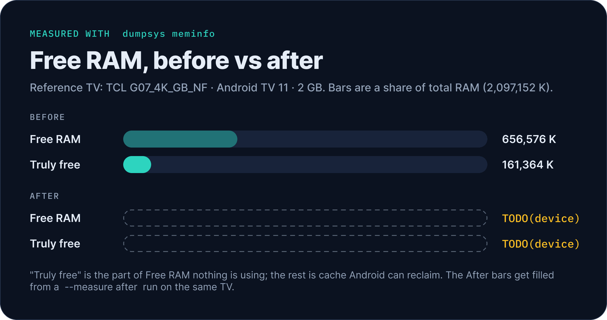

# Results

Measured with `dumpsys meminfo` about 2 minutes after a fresh boot. Only real measurements go here. Anything not
measured yet is marked `TODO(device)`.



## TCL G07_4K_GB_NF · Android TV 11 · RP1A.200622.001/AR17 · 2 GB RAM

| Metric | Before | After | Change |
|---|---|---|---|
| Free RAM | 656,576 K | TODO(device) | |
| └ truly free | 161,364 K | TODO(device) | |
| Used RAM | 1,551,191 K | TODO(device) | |
| Packages removed | | 23 | |
| YouTube cold start (`am start -W`) | TODO(device) | TODO(device) | |

**Subjective:** TODO(device), e.g. Home → YouTube, menu lag.

"Truly free" is the `free` part inside the Free RAM line; the rest of Free RAM is cache Android can reclaim.

## How to measure

The scripts take both snapshots and print the difference for you:

```powershell
powershell -ExecutionPolicy Bypass -File scripts\tv-debloat.ps1 192.168.1.50 -Measure before
```

```powershell
powershell -ExecutionPolicy Bypass -File scripts\tv-debloat.ps1 192.168.1.50 -Measure after
```

macOS / Linux: `./scripts/tv-debloat.sh 192.168.1.50 --measure before` and `--measure after`.

(A normal debloat run saves the "before" snapshot automatically.) Reboot and wait about 2 minutes before
`after`, otherwise you measure the boot, not the steady state.

By hand: steps 4 and 6 of the [walkthrough](WALKTHROUGH.md) save `before-mem.txt` and `after-mem.txt`.

**YouTube cold start**, the time to launch the app from scratch. Run it a few times and note the `TotalTime` values:

```cmd
adb -s %T% shell am force-stop com.google.android.youtube.tv
```

```cmd
adb -s %T% shell am start -W -n com.google.android.youtube.tv/com.google.android.apps.youtube.tv.activity.ShellActivity
```

`TODO(device)`: confirm the YouTube activity name on the G07 (`adb -s %T% shell cmd package resolve-activity --brief com.google.android.youtube.tv`).

## Add your model

Open an issue with the **Model report** template: model and firmware, before/after meminfo, which packages you
removed, and anything that broke. See [CONTRIBUTING.md](../CONTRIBUTING.md).
