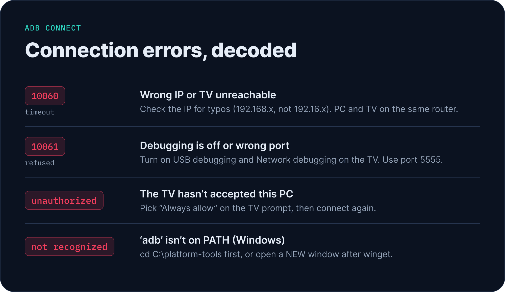

# Troubleshooting

Every problem on this page happened for real while debloating the reference TV from Windows `cmd`.



| You see | Meaning | Jump to |
|---|---|---|
| `'adb' is not recognized` | adb isn't on PATH in this window | [fix](#adb-is-not-recognized) |
| `... (10060)` | Wrong IP, or the TV is unreachable | [fix](#10060-connection-timed-out) |
| `... (10061)` | TV reachable, but debugging is off | [fix](#10061-connection-refused) |
| `unauthorized` | The TV hasn't accepted this PC | [fix](#unauthorized) |
| Only the first pasted line ran | adb swallowed the rest | [fix](#pasted-lines-didnt-run) |
| A command hangs or prints nothing | `\"` inside the quotes | [fix](#a-command-hangs-or-prints-nothing) |
| `Access is denied` saving a file | You're in `C:\Windows\System32` | [fix](#access-is-denied-when-saving-files) |
| `%T%` shows up literally / empty target | New window, variables gone | [fix](#the-t-variable-is-empty) |
| Model shows as `Smart TV` | TCL doesn't fill `ro.product.model` | [fix](#model-shows-as-smart-tv) |
| `Failure [not installed for 0]` | Already gone / not on this model | [fix](#failure-not-installed-for-0) |
| Removed apps still appear | Another Android user | [fix](#apps-are-still-there-for-another-user) |
| Home or Input button broke | A risky package was removed | [fix](#home-or-input-button-stopped-working) |
| No Network debugging toggle | Different firmware | [wireless](#wireless-debugging-android-11) · [USB](#usb-fallback) |

---

## Connection

### 'adb' is not recognized

`'adb' is not recognized as an internal or external command, operable program or batch file.`

adb isn't on the PATH of **this** cmd window. Either:

```cmd
set PATH=C:\platform-tools;%PATH%
```

or, if you installed with `winget install Google.PlatformTools`, close cmd and open a **new** window. winget's
PATH change only reaches windows opened after the install.

### 10060: connection timed out

`failed to connect to '192.168.1.50:5555': A connection attempt failed ... (10060)`

The PC can't reach that address at all.

- **Check the IP for typos.** The reference session lost time to `192.16.x` instead of `192.168.x`.
- PC and TV must be on the **same router**. Guest Wi-Fi and "AP isolation" block this, and so does a second router
  in between (double NAT).
- Test from PowerShell: `Test-NetConnection 192.168.1.50 -Port 5555`. `TcpTestSucceeded : True` means the network
  is fine.

### 10061: connection refused

`No connection could be made because the target machine actively refused it. (10061)`

The TV answered, but nothing listens on port 5555.

- Turn on **USB debugging** *and* **Network debugging** in Developer options. If they're already on, toggle them
  off and on.
- Wake the TV. Some firmware stops listening in standby.
- Check that you used port `:5555` (unless you use [wireless debugging](#wireless-debugging-android-11)).

### unauthorized

`adb devices` lists `192.168.1.50:5555   unauthorized`.

The TV shows an "Allow USB debugging?" prompt that wasn't accepted. Look at the TV and:

```cmd
adb kill-server
```

```cmd
adb connect %T%
```

Tick **Always allow from this computer** and press **OK**. If no prompt appears, toggle USB debugging off and on.

### Wireless debugging (Android 11+)

Some firmware shows **Wireless debugging** instead of **Network debugging**. It uses a random port and needs a
one-time pairing code. Open **Wireless debugging → Pair device with pairing code** on the TV, then:

```cmd
adb pair 192.168.1.50:<pairing-port>
```

Enter the code shown on the TV. Then connect to the port on the **main** Wireless debugging screen (not the
pairing port):

```cmd
set T=192.168.1.50:<port-on-main-screen>
```

```cmd
adb connect %T%
```

### USB fallback

No network debugging option at all? Connect a **USB-A ↔ USB-A** cable between PC and TV, then:

```cmd
adb devices
```

```cmd
adb tcpip 5555
```

Unplug the cable and continue from [step 3](WALKTHROUGH.md#step-3-connect).

---

## Windows cmd gotchas

### Pasted lines didn't run

You pasted several commands at once and only the first one ran. Later ones fail oddly, e.g.
`The system cannot find the file specified` (on a Turkish Windows: `Sistem belirtilen dosyayı bulamıyor`).

`adb shell` reads from the same input as cmd, so the first `adb shell` swallows the following lines as its own
input. Fixes, from simplest:

1. **Paste one command at a time.** That's why the walkthrough has one command per block.
2. Put several commands on one line inside **one** `adb shell "a; b; c"`, as in steps 5 and 6.
3. Use the scripts: they give adb an empty input on purpose (`< /dev/null` / `$null |`).

### A command hangs or prints nothing

You wrote `\"` inside a quoted `adb shell "..."` command. cmd does **not** treat `\"` as an escaped quote: it ends
the string there, and the rest gets mangled. Use single quotes inside the double quotes, exactly like the
walkthrough does:

```cmd
adb -s %T% shell "dumpsys meminfo | grep -E 'Free RAM|Used RAM'"
```

### Access is denied when saving files

cmd starts in `C:\Windows\System32`, which normal users can't write to, so `> before-mem.txt` fails. Work in your
own folder:

```cmd
mkdir %USERPROFILE%\tcl-tv
```

```cmd
cd %USERPROFILE%\tcl-tv
```

Also: cmd has no `ls`. Use `dir` to list files and `type file.txt` to show one.

### The T variable is empty

`set T=...`, `set U=...` and `set PATH=...` only live in the cmd window where you typed them. In a new window,
`%T%` is passed through literally and adb fails. Set them again:

```cmd
set PATH=C:\platform-tools;%PATH%
```

```cmd
set T=192.168.1.50:5555
```

```cmd
set U=0
```

---

## On the TV

### Model shows as Smart TV

`getprop ro.product.model` returns `Smart TV` on TCL. Use these instead:

```cmd
adb -s %T% shell getprop ro.product.name
```

```cmd
adb -s %T% shell getprop ro.product.device
```

The reference TV reports `G07_4K_GB_NF` as `ro.product.name`.

### Failure [not installed for 0]

The package is already removed for that user, or your model never had it. Nothing to do.

### Apps are still there for another user

`pm uninstall -k --user N` removes an app for **one** Android user. The reference TV has two users (`0` and `10`).

```cmd
adb -s %T% shell pm list users
```

```cmd
adb -s %T% shell am get-current-user
```

The TV normally runs as the current user, so that's the one that matters for speed and what you see. To remove
the apps for another user too, repeat the debloat with `set U=<other id>`, or run the script with `--user <id>`
(`-User <id>` in PowerShell).

`TODO(device)`: confirm which user is active on the G07 and what user 10 is used for.

### Home or Input button stopped working

Put back the last package you removed. If you don't know which, start with the risky ones:

```cmd
adb -s %T% shell cmd package install-existing --user %U% com.tcl.waterfall.overseas
```

```cmd
adb -s %T% shell cmd package install-existing --user %U% com.google.android.apps.tv.launcherx
```

Then reboot (`adb -s %T% reboot`). If nothing helps: **Settings → System → Reset → Factory reset** brings back
every app.

### The privacy report says an app used the mic "-225d…"

That's not a recording. See [PRIVACY.md](PRIVACY.md#reading-the-timestamps): it's the time since the app **last**
opened the microphone (225 days ago in that example).
