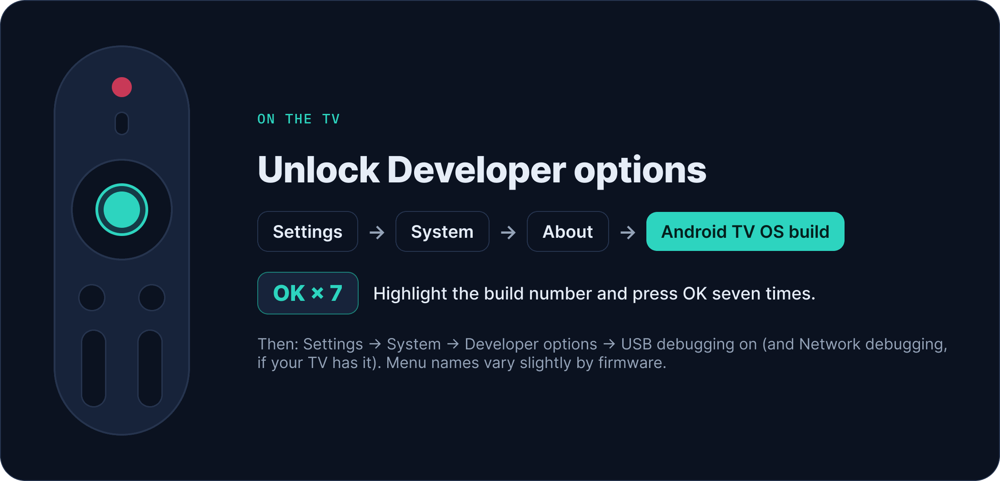
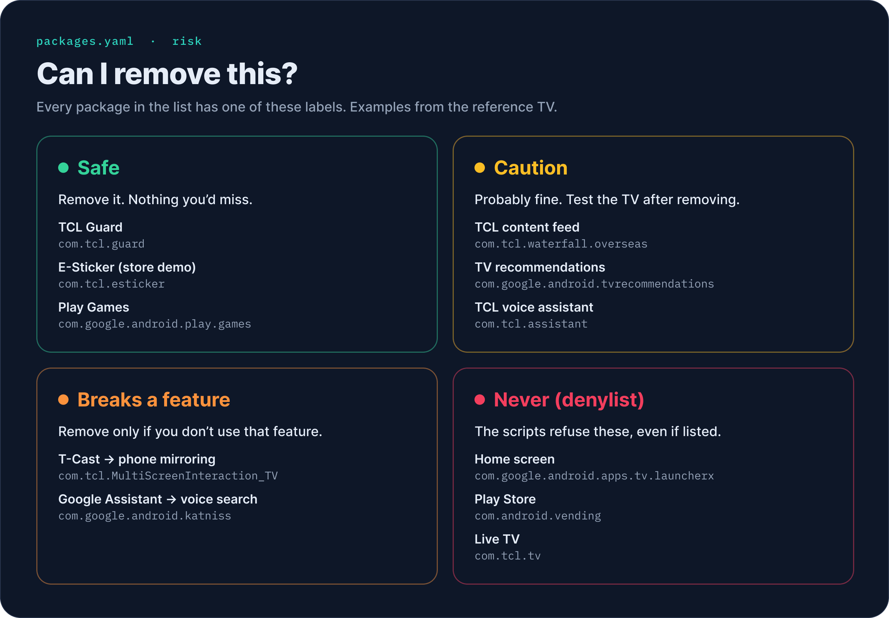
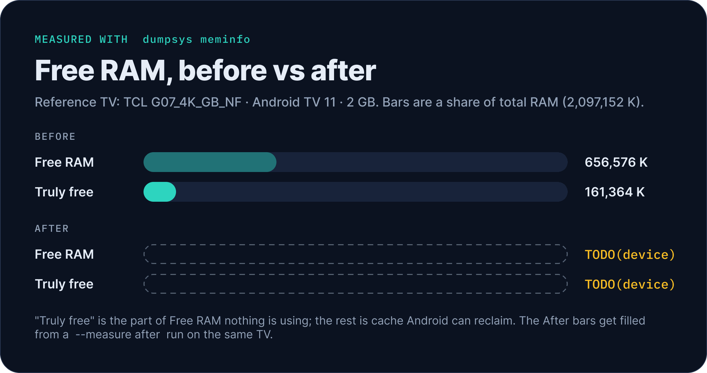

# Walkthrough: debloat an Android TV / Google TV from Windows cmd, no scripts needed

This is the exact path that worked on the reference TV, a **TCL G07_4K_GB_NF (Android TV 11, 2 GB RAM)**. The steps are the same on any Android TV / Google TV; the app names in step 5 are from that TCL, so on other brands remove only what you recognise. It uses only `cmd` and
ADB: no Git Bash, no WSL, no root. Every step can be undone.

**Time:** about 20 minutes · **Risk:** low. Apps are removed for one Android user only, and a factory reset
restores everything.

> [!NOTE]
> Windows `cmd` comes first in every step. macOS and Linux commands are in the collapsible **macOS / Linux**
> sections. Prefer a script? See the [README](../README.md). This page is the manual path.
>
> Not affiliated with TCL or Google. Use at your own risk.

**Steps:**
[1 Developer options](#step-1-enable-developer-options) ·
[2 Install ADB](#step-2-install-adb) ·
[3 Connect](#step-3-connect) ·
[4 Baseline](#step-4-baseline) ·
[5 Debloat](#step-5-debloat) ·
[6 Tweaks & reboot](#step-6-tweaks--reboot) ·
[7 Privacy check](#step-7-privacy-check) ·
[8 Home screen](#step-8-home-screen-optional) ·
[9 Turn off debugging](#step-9-turn-off-debugging) ·
[Undo](#undo)

<details>
<summary><b>Why is the TV slow?</b></summary>

On the reference TV, `dumpsys meminfo` showed:

```
Total RAM: 2,097,152K
 Free RAM:   656,576K (285,320K cached pss + 209,892K cached kernel + 161,364K free)
 Used RAM: 1,551,191K
```

Only about **160 MB was truly free**. Every time you open an app, Android first has to kill something else.
Removing apps that keep running in the background is what makes the TV faster.

</details>

---

## Step 1: Enable Developer options


⏱ ~2 min · on the TV, with the remote



1. **Settings → System → About** → highlight **Android TV OS build** and press **OK 7 times**.
   A message tells you that you're now a developer.
2. **Settings → System → Developer options** → turn on **USB debugging**.
3. If there's a **Network debugging** toggle, turn it on too.
   If you see **Wireless debugging** instead, use [these steps](TROUBLESHOOTING.md#wireless-debugging-android-11).
4. Write down the TV's IP address: **Settings → Network & Internet →** your Wi-Fi network.

> [!TIP]
> Menu names vary a little between firmware versions. Look for the same words.

## Step 2: Install ADB


⏱ ~3 min · on the PC

The most reliable way needs no installer:

1. Download <https://dl.google.com/android/repository/platform-tools-latest-windows.zip>
2. Extract it so that `C:\platform-tools\adb.exe` exists.
3. Open **cmd** (Start → type `cmd` → Enter) and make `adb` available in this window:

```cmd
set PATH=C:\platform-tools;%PATH%
```

✅ **You should see:** nothing. That's normal.

```cmd
adb version
```

✅ **You should see:**

```
Android Debug Bridge version 1.0.41
...
```

The version number may differ.

> [!IMPORTANT]
> `set PATH=...` only lasts for **this cmd window**. If you open a new window, run it again.
> `winget install Google.PlatformTools` also works, but only in a **new** window opened after the install.

❌ **If you see** `'adb' is not recognized as an internal or external command`, see
[TROUBLESHOOTING](TROUBLESHOOTING.md#adb-is-not-recognized).

<details>
<summary><b>macOS / Linux</b></summary>

```sh
brew install android-platform-tools      # macOS (Homebrew)
```

```sh
sudo apt install adb                     # Debian / Ubuntu
```

```sh
adb version
```

</details>

## Step 3: Connect


⏱ ~2 min · the PC can be wired and the TV on Wi-Fi. They only need to be on the **same router**.

Make a working folder. The default cmd folder (`C:\Windows\System32`) isn't writable, so saving files there fails.

```cmd
mkdir %USERPROFILE%\tcl-tv
```

```cmd
cd %USERPROFILE%\tcl-tv
```

Store the TV's address in `T` (use **your** IP from step 1, plus `:5555`):

```cmd
set T=192.168.1.50:5555
```

```cmd
adb connect %T%
```

✅ **You should see:** `connected to 192.168.1.50:5555`. A prompt appears on the TV: tick **Always allow** and
press **OK**.

```cmd
adb devices
```

✅ **You should see:**

```
List of devices attached
192.168.1.50:5555       device
```

> [!WARNING]
> `set T=...` only lasts for this cmd window, like `PATH`. In a new window, set both again.

❌ **If you see** `(10060)` → [wrong IP / unreachable](TROUBLESHOOTING.md#10060-connection-timed-out) ·
`(10061)` → [debugging off](TROUBLESHOOTING.md#10061-connection-refused) ·
`unauthorized` → [accept the prompt](TROUBLESHOOTING.md#unauthorized)

<details>
<summary><b>macOS / Linux</b></summary>

```sh
mkdir -p ~/tcl-tv && cd ~/tcl-tv
```

```sh
T=192.168.1.50:5555
```

```sh
adb connect $T
```

```sh
adb devices
```

In every later step, use `$T` where Windows uses `%T%` (and `$U` for `%U%`).

</details>

## Step 4: Baseline


⏱ ~1 min · saves "before" numbers so you can see the difference later

> [!WARNING]
> **Paste one command at a time.** If you paste several lines at once, the first `adb shell` swallows the rest
> as its input and they never run.

```cmd
adb -s %T% shell getprop ro.product.name > device.txt
```

✅ **You should see:** nothing. The output goes into `device.txt`.
`ro.product.model` only says `Smart TV` on TCL, which is why this uses `ro.product.name`.

```cmd
adb -s %T% shell getprop ro.build.fingerprint >> device.txt
```

```cmd
adb -s %T% shell "dumpsys meminfo | grep -E 'Total RAM|Free RAM|Used RAM'" > before-mem.txt
```

```cmd
type before-mem.txt
```

✅ **You should see** three lines like this (the reference TV's numbers):

```
Total RAM: 2,097,152K
 Free RAM:   656,576K (285,320K cached pss + 209,892K cached kernel + 161,364K free)
 Used RAM: 1,551,191K
```

```cmd
adb -s %T% shell "pm list packages | sed 's/package://' | sort" > installed.txt
```

Open `installed.txt` and compare it with [`packages.yaml`](../packages.yaml) to see which listed apps your TV has.

**Which Android user are you?** Removals only apply to one user, so check:

```cmd
adb -s %T% shell pm list users
```

✅ **You should see** one or more `UserInfo{...}` lines. The number right after `{` is the user id.
The reference TV listed **two** users: `0` and `10`.

```cmd
adb -s %T% shell am get-current-user
```

✅ **You should see** a single number, e.g. `0`. Store it in `U`:

```cmd
set U=0
```

> [!NOTE]
> If the TV has more than one user, apps you remove for user `U` stay installed for the others. That's harmless,
> but if you want them gone everywhere, repeat step 5 with `set U=10` (or whatever the other id is).
> See [TROUBLESHOOTING](TROUBLESHOOTING.md#apps-are-still-there-for-another-user).

## Step 5: Debloat


⏱ ~4 min

This is **one line**. It runs everything inside a single `adb shell`, so the paste problem can't happen.
Every package here is labelled *safe* or *breaks a feature you can live without* in
[`packages.yaml`](../packages.yaml):

```cmd
adb -s %T% shell "for p in com.tcl.guard com.tcl.esticker com.tcl.smartalexa com.tcl.notereminder com.tcl.messagebox com.tcl.hotelmenu com.tcl.channelplus com.tcl.usercenter com.tcl.browser com.tcl.gallery com.tcl.MultiScreenInteraction_TV com.google.android.youtube.tvmusic com.google.android.play.games com.google.android.videos com.google.android.feedback com.google.android.marvin.talkback com.google.android.apps.tv.dreamx com.android.printspooler com.android.wallpaper.livepicker; do echo $p; pm uninstall -k --user %U% $p; done"
```

✅ **You should see** each package name followed by one of:

- `Success`: removed.
- `Failure [not installed for 0]`: already gone or not on your model. That's fine.

> [!CAUTION]
> Never put `\"` inside the quotes. cmd doesn't treat it as an escape: the command hangs or silently does nothing.
> Copy the line exactly as it is.

`com.tcl.MultiScreenInteraction_TV` is T-Cast. Leave it out of the line if you mirror from TCL's phone app.

**Streaming apps you don't use.** Edit the names to suit you. The reference TV kept YouTube, Netflix, Prime Video,
HBO Max and Spotify:

```cmd
adb -s %T% shell "for p in com.disney.disneyplus com.dsmart.blu.android tv.wuaki.apptv au.com.stan.and; do echo $p; pm uninstall -k --user %U% $p; done"
```

**Optional, test the TV after each one:**

| What you lose | Command |
|---|---|
| TCL content rows. Check that **Home** and **Input** still work afterwards | `adb -s %T% shell pm uninstall -k --user %U% com.tcl.waterfall.overseas` |
| Voice search / remote mic button | `adb -s %T% shell "pm uninstall -k --user %U% com.google.android.katniss; pm uninstall -k --user %U% com.google.android.tv.assistant"` |



> [!CAUTION]
> **Never remove** anything on the [denylist](../packages.yaml), such as `com.google.android.apps.tv.launcherx`
> (Home), `com.tcl.tv` / `com.tcl.tvinput` (Live TV), `com.tcl.dashboard`, `com.tcl.autopair` (remote pairing)
> or `com.google.android.apps.mediashell` (Chromecast). The scripts refuse these. By hand, nothing stops you.

## Step 6: Tweaks & reboot


⏱ ~3 min, mostly waiting for the reboot

Halve the animation time, which makes the menus feel snappier:

```cmd
adb -s %T% shell "settings put global window_animation_scale 0.5; settings put global transition_animation_scale 0.5; settings put global animator_duration_scale 0.5"
```

✅ **You should see:** nothing.

```cmd
adb -s %T% reboot
```

Wait about 2 minutes until the home screen is back, then:

```cmd
adb connect %T%
```

```cmd
adb -s %T% shell "dumpsys meminfo | grep -E 'Free RAM|Used RAM'" > after-mem.txt
```

```cmd
type after-mem.txt
```

Compare it with `before-mem.txt`.



The reference TV's numbers are in [RESULTS.md](RESULTS.md).

## Step 7: Privacy check


⏱ ~2 min · read-only: it changes nothing on the TV

Download this repository (**Code → Download ZIP** on GitHub) and extract it, e.g. to `C:\tv-debloat-android-google`. Then,
still in your `%USERPROFILE%\tcl-tv` window:

```cmd
C:\tv-debloat-android-google\scripts\privacy-audit.bat %T%
```

✅ **You should see** the report scroll by, ending with
`Saved to privacy-report.txt. Nothing on the TV was changed.`

[PRIVACY.md](PRIVACY.md) explains every section, including the scary-looking `(-225d21h26m…)` timestamps:
they mean "last used 225 days ago", not "recording".

> [!WARNING]
> `privacy-report.txt` describes your TV. Don't post it publicly.

<details>
<summary><b>macOS / Linux</b></summary>

```sh
./scripts/privacy-audit.sh 192.168.1.50
```

It writes `reports/<timestamp>-privacy.txt` and puts a short Findings summary at the top.

</details>

## Step 8: Home screen (optional)


⏱ ~5 min

For a cleaner home screen without ads rows, use **Projectivy Launcher** and its **Override current launcher**
option. The full setup, and how to undo it, is in [LAUNCHER.md](LAUNCHER.md).

> [!CAUTION]
> Don't disable `launcherx` (the stock home screen) with ADB. Some guides tell you to, but it can break the Home
> button and input switching. The override gets the same result safely.

## Step 9: Turn off debugging


⏱ ~1 min · don't skip this

```cmd
adb disconnect %T%
```

Then on the TV: **Settings → System → Developer options** → **Network debugging** and **USB debugging** → **off**.

> [!IMPORTANT]
> While debugging is on, anything on your Wi-Fi that the TV once trusted can control it fully. Turn it back on
> only when you need it.

---

## Undo

**One package** (works after a removal by this walkthrough or by the scripts):

```cmd
adb -s %T% shell cmd package install-existing --user %U% com.tcl.guard
```

✅ **You should see:** `Package com.tcl.guard installed for user: 0`

**Animation speed** back to normal:

```cmd
adb -s %T% shell "settings put global window_animation_scale 1; settings put global transition_animation_scale 1; settings put global animator_duration_scale 1"
```

**Everything:** **Settings → System → Reset → Factory reset**. The apps were never deleted from the system
partition, so a reset brings all of them back (and erases your settings and sign-ins).

Something went wrong? See [TROUBLESHOOTING.md](TROUBLESHOOTING.md).
