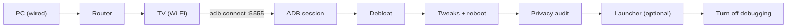

# Design assets

Images used by the README and the docs. All are **PNG @2x** with transparent rounded corners: each one is a
self-contained dark card, so it reads the same on GitHub's light and dark themes.

- **Source:** the PNGs here are the published versions. The editable design files are kept by the maintainer;
  open an issue to request a change.
- **Style:** dark navy cards (`#0B1220`), one teal accent (`#2DD4BF`), Inter for text, IBM Plex Mono for code and
  labels, rounded corners, no gradients or blurs.
- No brand logos or assets. The TV and the remote are drawn generically. Not affiliated with TCL or Google.
- License: MIT, like the rest of the repo. Fonts used: Inter and IBM Plex Mono (SIL Open Font License 1.1),
  rendered into the images. The 9 icons were drawn for this project (no icon library).

## Files, alt text and text fallbacks

Use the alt text below verbatim. Every image that carries information also has a text fallback in the doc that
embeds it, so the repo stays readable without images.

| File | Alt text | Text fallback |
|---|---|---|
| `hero-banner.png` | smart-tv-debloat: Make a slow Android TV / Google TV fast and private again, reversibly. No root, fully reversible, about 20 minutes. | The README's first paragraph |
| `how-it-works.png` | How it works: a wired PC and a Wi-Fi TV on the same router connect over ADB on port 5555; then debloat, tweaks and reboot, privacy audit, optional launcher, and finally turn debugging off. | Mermaid block below |
| `step-01-enable-developer-options.png` | Step 1: Enable Developer options, about 2 minutes | Step heading |
| `step-02-install-adb.png` | Step 2: Install ADB, about 3 minutes | Step heading |
| `step-03-connect.png` | Step 3: Connect, about 2 minutes | Step heading |
| `step-04-baseline.png` | Step 4: Baseline, about 1 minute | Step heading |
| `step-05-debloat.png` | Step 5: Debloat, about 4 minutes | Step heading |
| `step-06-tweaks-reboot.png` | Step 6: Tweaks and reboot, about 3 minutes | Step heading |
| `step-07-privacy-check.png` | Step 7: Privacy check, about 2 minutes | Step heading |
| `step-08-home-screen.png` | Step 8: Home screen (optional), about 5 minutes | Step heading |
| `step-09-turn-off-debugging.png` | Step 9: Turn off debugging, about 1 minute | Step heading |
| `ram-before-after.png` | Free RAM on the reference TV (2 GB) before debloating: 656,576 K free, of which 161,364 K truly free. After values not measured yet. | `docs/RESULTS.md` table |
| `decision-chart.png` | Can I remove this? Safe (e.g. com.tcl.guard), Caution (e.g. com.tcl.waterfall.overseas), Breaks a feature (e.g. com.google.android.katniss breaks voice search), Never (e.g. com.google.android.apps.tv.launcherx, the home screen). | `packages.yaml` + table in README |
| `error-codes.png` | ADB connection errors: 10060 means wrong IP or unreachable; 10061 means debugging off or wrong port; unauthorized means accept the prompt on the TV; not recognized means adb is not on PATH. | `docs/TROUBLESHOOTING.md` table |
| `tv-remote-developer-options.png` | Generic TV remote with the OK button highlighted. Settings, System, About, Android TV OS build: press OK seven times. | Step 1 text |

The step times are estimates that add up to the ~20 minute total, not measurements.

### How it works (Mermaid fallback)

## Updating an asset

1. Edit the design in any tool, keeping the style above (maintainer: in the design file, change step text through
   the `StepCard` instance properties, not by detaching).
2. Export at 2x as PNG with a transparent background.
3. Shrink it to a 256-colour palette so it stays well under 300 KB:
   `python -c "from PIL import Image; im=Image.open('x.png').convert('RGBA'); im.quantize(256, method=Image.Quantize.FASTOCTREE).save('x.png', optimize=True)"`
4. Keep the file name; update the alt text above if the content changed.

**Why PNG, not SVG:** the SVG exports need outlined text to look right without the Inter font installed, and
that made the text-heavy cards 330–580 KB. The palette PNGs are 6–75 KB each.
Avoid blurs and large gradients: they quantise into visible bands (the hero's glow was removed for that reason).
